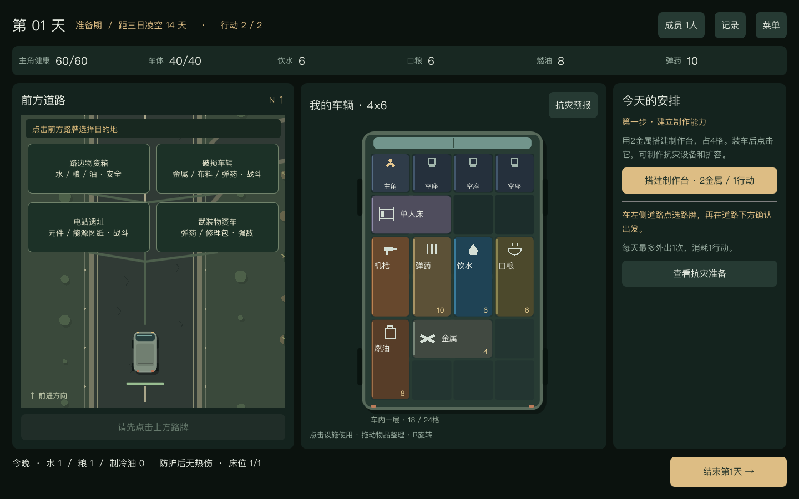

# Roadseer · 片段一：三日凌空

Godot PC 可玩原型：**前14天搜集与建设，后7天承受高温，活过第21天。** 验证车辆背包的空间取舍能否服务于明确的阶段目标。当前数值用于首轮试玩，尚未完成平衡或真人体验验收。

## 启动

在仓库根目录执行：

```sh
./godot-engine/play.command
```

也可在 Finder 中双击 `play.command`。脚本使用 `/Applications/Godot.app/Contents/MacOS/Godot`，可用 `ROADSEER_GODOT_BIN` 指定其他位置。当前验证环境是 macOS / Godot 4.6.2，尚无 Windows 发行包。退出会丢失本局，没有存档和局外成长。

## 第一轮怎么玩

1. 在首页点击“搭建制作台”，花2金属制造，成品出现在车厢下方的待装区。
2. 初始车厢4×6，驾驶位与3个客座各占1格，主角坐驾驶位，客座为空；开局有一张占2格的单人床。车辆竖向展示，车头朝上；左侧道路和中间车厢同时可见。点选金属，按R旋转并放回原位置，腾出右下角2×2，把制作台装进去。
3. 直接点击左侧道路的“破损车辆”路牌，在道路下方确认出发；右侧只展示该路线的情报。先经过约3秒的道路行进，小爱随后自动射击，胜利后打开物资箱。点选地面金属，再点车内金属可合并；弹药也可合并。装不下的布料可以暂时放弃，后续拆解线仍能获得。
4. 结束第1天，结算1水、1粮。第2天点击车内制作台，用6金属和1行动扩容到4×8，再出发搜集。以后还能用8金属扩成4×10。
5. 点击车内制作台打开配方，选择建设方向：隔热层用金属和布料；发电机＋制冷机需要先探索电站遗址取得图纸和元件。设备要装车才生效。
6. 车厢右上角“抗灾预报”会按当前装车配置与燃油，计算剩余灾难夜晚所需的水、粮、制冷油与健康净损失。预演假设期间不外出、不生产、不换装，准备期剩余消耗需要另留。
7. 第15天高温到来。可以驻车度日，也可冒险外出补给、搜材料、应急制作；完成第21天夜间结算即成功。



布局设计与具体交互见[车辆中心UI说明](../docs/gdd/UI布局与交互.md)。

## 操作与时间

- 每天2行动，最多外出1次。外出、制作和扩容各耗1行动；摆放、合并、使用现有修理包不耗行动。未用行动不结转。
- 点击车内物品先查看／使用：制作台展开配方和扩容，制冷机展开运行开关，修理包展开使用操作。
- 整理时直接拖动，或点“移动”／按R再点击目标格；右键或Esc取消。地面物品点击后进入放置，同类箱子可合并至上限，多余数量仍保留。
- 材料必须装车才能制作。所有成品明确生成在地面，因此即使车内满载也能制作，之后必须整理并装车。失败的制作不扣材料与行动。
- “放到地面”可临时腾位。**外出和结束当天都会离开当前停靠点**，地面物品需装车，否则经弹窗确认后放弃；没有无限地面仓库。
- 默认只有主角1人，HUD“成员1人”可查看座位与床位；另外3个客座空置，小爱属于车载自动系统，不计入人数。人物附着于座位，不另占背包格；移动驾驶位时主角随座位移动。出发必须有主角在车内驾驶位。
- 单人床占2格、可旋转，每张只分配1人。开局自带1张，夜间结算时主角自动使用；无热伤、无缺水缺粮且有床时恢复2健康。床在地面不生效，无床不恢复，不新增疲劳条。制作替代床无需制作台，成品仍需装车。
- 夜间生存消耗和睡眠只在点击“结束当天”时结算一次，整理不会刷产出。驻车也会消耗水粮。
- 道路常驻左侧。选择路线会预览物资箱、破损车辆、电站或武装物资车；出发后地面向下滚动，车辆保持下方。生活补给线在准备期抵达后需点击道路箱子或“打开物资箱”；敌对路线抵达后自动战斗。四个路牌可直接点击选择，标明资源与敌情；服务区经营、僵尸和机缘事件尚未实现。
- 行进和战斗期间车厢可见但锁定布局，Space暂停／继续，可切换×1／×2。金色弹道为己方开火，红色为敌方攻击，蓝色为防护；记录会说明耗弹、减伤和车损。缺弹时应急撞击会损伤车辆。
- 扩容车厢可独立纵向滚动；格子保持可读大小，拖动物品靠近车厢上/下边缘会滚动。菜单中可开启“减少道路动态”，停止背景连续滚动，保留事件和战斗反馈。
- 右侧展开的面板可滚动。配方详情可追踪材料缺口；左侧路牌选路后在道路下方确认出发，右侧不重复展示路线列表。日志收在顶部“记录”，需要时可刷新。

## 搜集与制作

| 路线 | 固定物资箱 | 敌情与图纸 |
|---|---|---|
| 生活补给线 | 水6、粮4、油3 | 准备期安全；高温期有热兽 |
| 废车拆解线 | 金属4、布料3、弹药4 | 自动战斗后开箱 |
| 电站遗址线 | 元件3、金属2、油4 | 自动战斗；首次保证学会发电机和制冷机图纸 |
| 武装物资箱 | 弹药10、修理包1、布料2 | 装甲守卫，耗弹与车损更高 |

| 配方 | 材料 | 占格 / 效果 |
|---|---|---|
| 单人床 | 金属2、布料2 | 1×2，供1人睡眠；可旋转，无需制作台即可制作 |
| 制作台 | 金属2 | 2×2；自身无需制作台，其余配方及扩容需要车内制作台 |
| 隔热层 | 金属2、布料4 | 2×2；被动减热2，不耗油 |
| 发电机 | 金属3、元件2 | 1×2；支持制冷机 |
| 制冷机 | 金属2、元件2、布料1 | 2×2；配套发电机且启用时，高温夜间耗1油、减热3 |
| 装甲板 | 金属3 | 1×2；每次敌方攻击减伤1 |
| 修理包 | 金属2、布料1 | 1×2；使用1份修复10车体耐久 |

隔热、制冷和装甲各只计算一套，隔热与制冷可以叠加。制作台、隔热、装甲与修理包图纸开局已知；能源图纸保证在电站取得。图纸只在本局保留，不占车格。

水、粮、油、弹药每箱最多12；金属、布料和元件每箱最多8；修理包每箱最多2。补给和材料箱均占2格，没有隐藏数字仓库。

## 灾难结算

第15—21天热强度依次为 **3、3、4、5、5、4、3**。这是游戏规则，不是现实温度或工程参数。

- 余热＝热强度－隔热2－运行中的制冷3，最低0。
- 每晚需水＝1＋向上取整（余热÷2），需粮1；每级余热扣4乘员健康。制冷开启但没有发电机或燃油时停机，预报同步反映。
- 每缺1水再扣6健康，每缺1粮再扣4；完全无损且有床可睡的夜晚恢复2健康，上限60。车体耐久独立计算，上限40。
- 准备期外出需1油；高温期需2油＋1水，并因暴晒扣2健康，敌人生命或伤害提高。油不够会阻止外出，但仍允许驻车，停车不会自动失败。
- 乘员健康或车体耐久归零即失败，记录明确给出热伤、缺水、缺粮或战损。第21天夜间生存即胜利，不要求指定装备。

旧版的集水器、厨房等基础定义保留在代码中，但当前路线和配方不提供这些设备。集水器规则已改为准备期每晚1水、高温期0水；本轮不以无条件产水解决灾难。

## 验证与边界（2026-10-23）

通过 Godot CLI 驱动真实状态模型，从第1天按规则搜集、装箱、制作、扩容与结算：

- 隔热＋储水：完成21天，健康8、车体29。
- 发电＋制冷：完成21天，健康38、车体29。
- 在合法准备局面中消耗库存制造缺水条件，验证灾难期外出补水、次日拆解取材并应急制作修理包，然后完成余下周期。
- 检查材料不足／图纸未学会不扣料，重叠与越界不丢物，地面放弃确认，每天外出上限、行动上限、战斗锁定，以及断油停机和驻车、准备不足的失败。
- 首轮布局检查及本次重排都通过引擎视口输入验证；本次另检查了设备点击展开、移动与查看分离、图纸追踪、竖向网格拖动和地面物资拖入。制作、拾取、非法放置、R旋转、装车、选路、战斗暂停／继续、预报页及制冷开关均有覆盖；弹窗取消通过按钮信号验证回调。检查第15天和第21天画面，并修正1280×820窗口的底部按钮与格子文字。Godot MCP 当前未接入，全程未用 Computer Use 操作 Godot。

尚未实现：第二周期、持续远征对比片段、剧情战役、特殊副本、二层与车顶、自由驾驶、乘员招募与复杂作息、正式美术与音效、存档。当前没有第14天快捷预设入口，完整准备阶段已验证。

仍需实际试玩判断：14天是否重复、制作是否有目标感、两条建设路线是否值得取舍、自动战斗能否看懂，以及一轮实际时长。脚本通关不能证明趣味性。

## 代码

- `scripts/vehicle_state.gd`：实体库存、配方、日内行动、路线、热负荷、纯预演与逐拍战斗。
- `scripts/main.gd`：车辆中心布局、设备情境面板、拖放输入、确认弹窗与日结。
- `scripts/vehicle_grid.gd`：竖向车辆展示、选择与放置反馈；扩容后在滚动容器内展示。
- `scripts/item_symbols.gd`、`scripts/cargo_card.gd`：原型设备图标与待装物资卡片。
- `scripts/road_view.gd`：常驻道路、行进动画、路线目标、物资箱交互、敌人、战斗血条/弹道/防护、高温场景。旧 `battle_view.gd` 不再由主界面使用。

### A 布局回归检查

```sh
/Applications/Godot.app/Contents/MacOS/Godot --path godot-engine --script res://tests/layout_a_input.gd
/Applications/Godot.app/Contents/MacOS/Godot --headless --path godot-engine --script res://tests/layout_a_drag.gd
```

第一项运行真实窗口和引擎输入事件，截图输出到 `/tmp/roadseer-layout-a-*.png`；覆盖安全开箱、出发重复点击、途中暂停、战斗与背包同屏、日结、扩容滚动及1280×820可见性。第二项检查拖动抓取偏移、非法落点、地面装车和Esc取消。只做界面检查的4×10与第15天画面使用测试局面；完整生存路线另由状态模型验证，二者不混作真人试玩结论。

### 路牌、成员与床位回归

```sh
/Applications/Godot.app/Contents/MacOS/Godot --headless --path godot-engine --script res://tests/crew_rules.gd
/Applications/Godot.app/Contents/MacOS/Godot --headless --path godot-engine --script res://tests/cycle_rules.gd
```

检查1格座位、主角入座绑定、空座不计人数、1床只能容纳1人、床在地面不生效、缺水时不因床回血、驾驶席缺员阻止出发，以及两条全程携带床铺的21天路线。`layout_a_input.gd` 另覆盖左侧路牌选择、右侧仅显示详情、左侧出发、座位/床点击和成员面板。

本轮落地测试结果、修复记录和第1—3天试玩步骤见[2026-10-23测试记录](../docs/testing/2026-10-23-playtest/README.md)。
